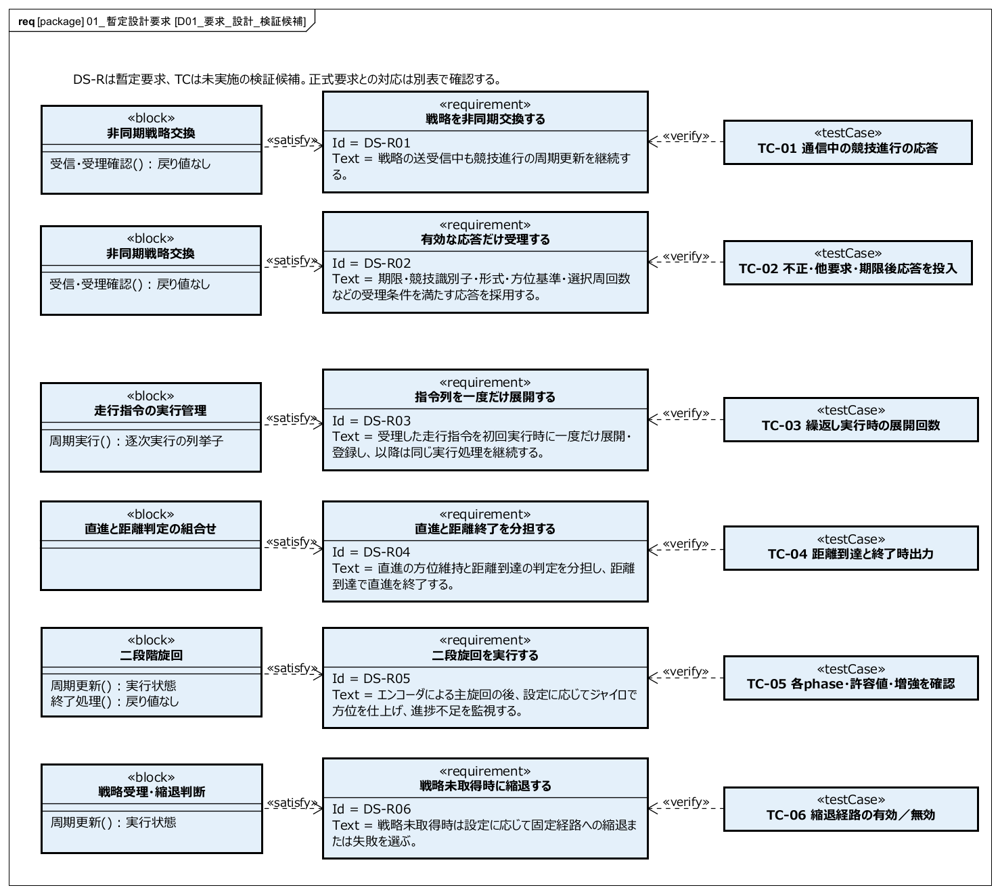
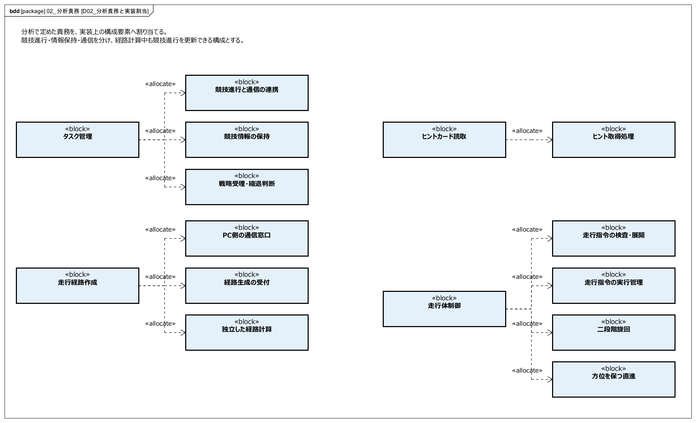
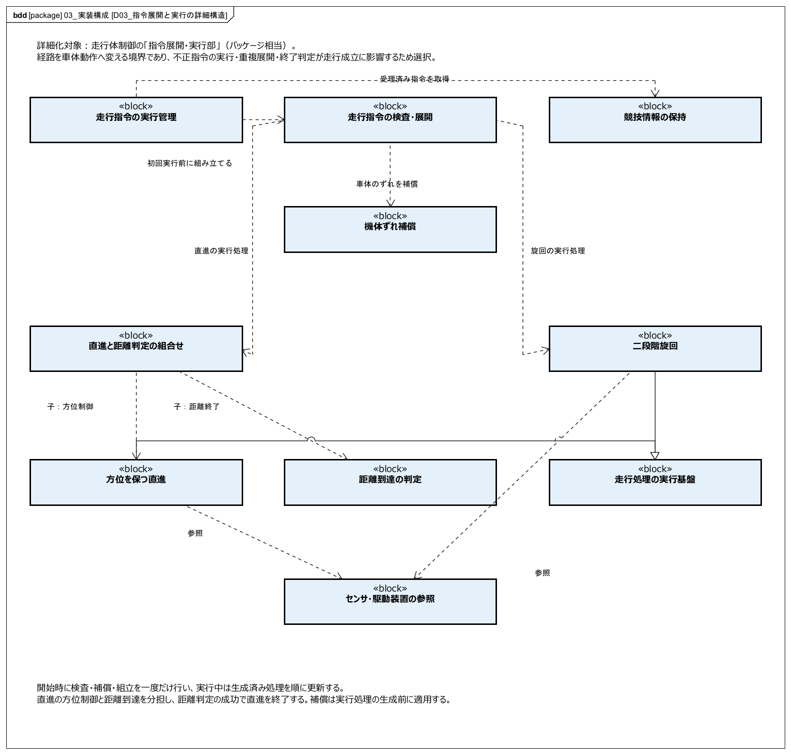
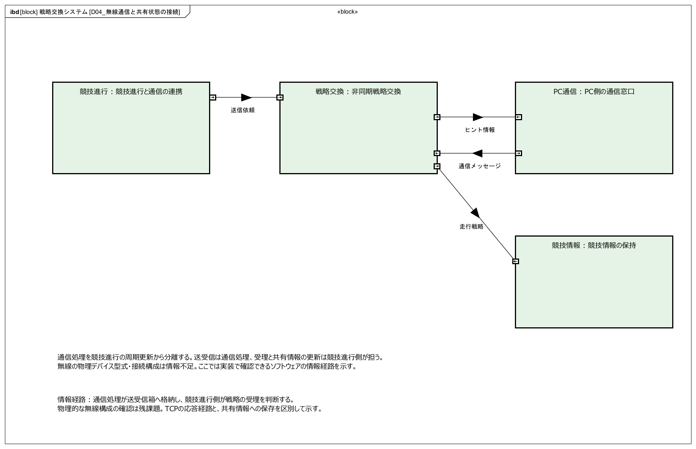
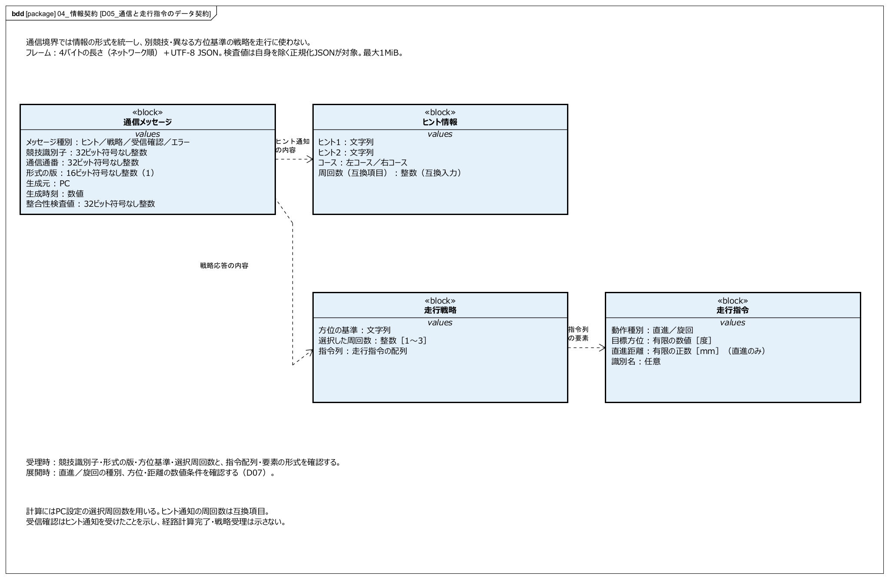
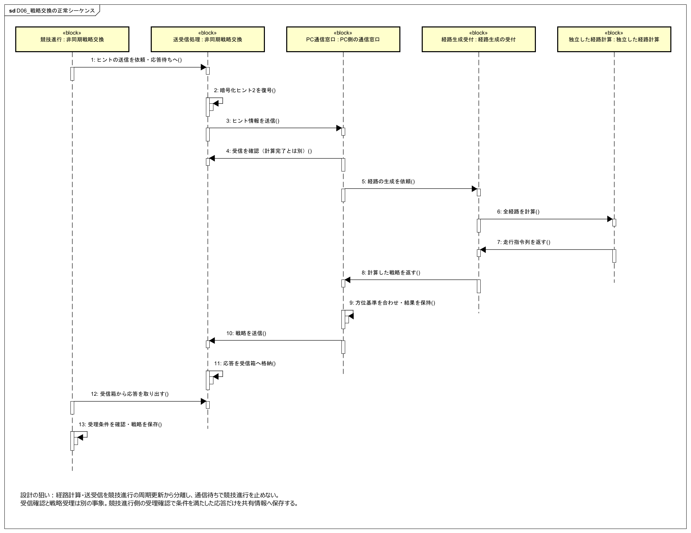
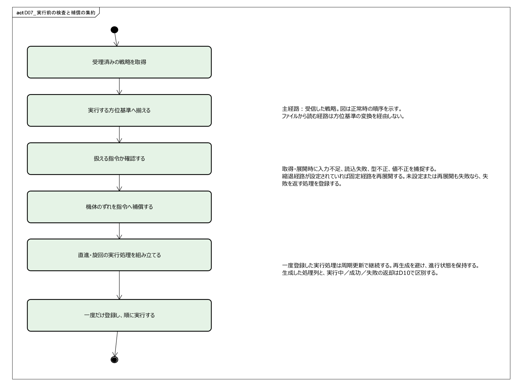
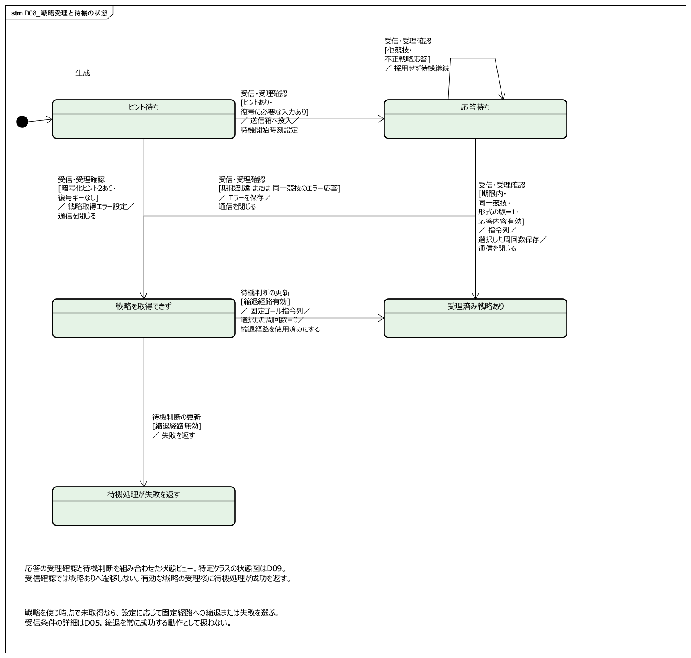
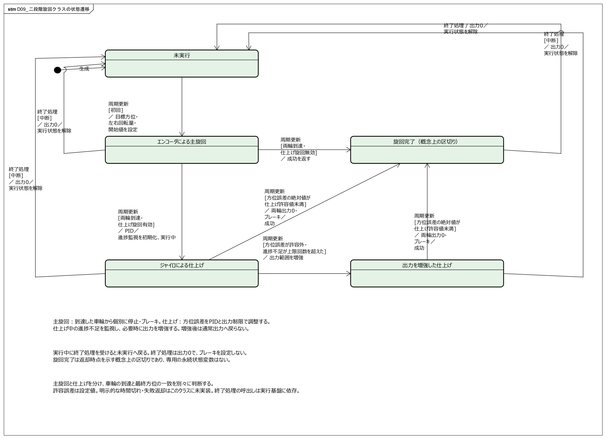
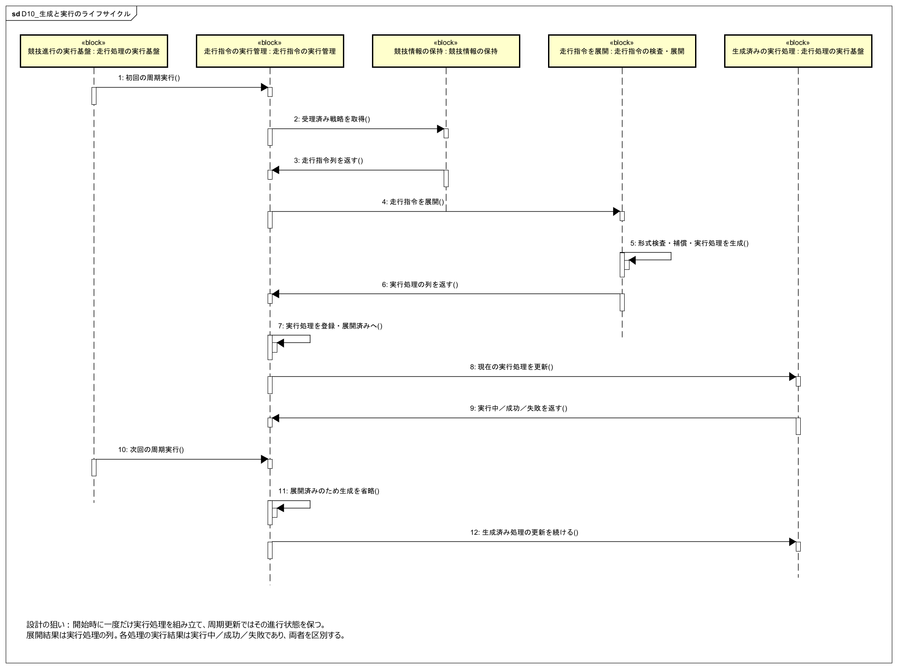

# ETロボコン 設計モデル

日本語・審査説明版。Astah SysMLで編集できる設計モデルと、同モデルから書き出した10図を公開するための資料です。

[図一覧](index.html)／[Astah SysMLモデル](設計モデル_日本語_審査説明版_v4.axmz)／[表示名と実装名](実装名対応表.md)／[トレーサビリティ](traceability.md)

## 説明の流れ

| 図 | 伝えること |
|---|---|
| D01 | 要求から設計・検証候補へたどる |
| D02 | 分析責務を構成要素へ割り当てる |
| D03 | 重要な構成要素の内部構造と選択理由 |
| D04 | 通信と共有情報の境界・受け渡し |
| D05 | 受け渡す情報と受理条件を定める |
| D06 | 通信待ちを競技進行から分離する |
| D07 | 実行前の検査・補償を一度に集約する |
| D08 | 戦略受理と未取得時の判断を区別する |
| D09 | 二段階旋回クラスの状態遷移 |
| D10 | 開始時の展開と実行中の更新を分ける |

要求→分析責務の割当→構成要素間の情報境界と協調→重要な構成要素の詳細→特定クラスの状態→検証候補の順で説明します。プログラムの処理名だけでなく、何を分担し、どこで判断し、どの情報を受け渡すかを示します。

## 確認範囲

これは正式提出物ではなく設計検討版です。DS-Rは暫定設計要求で、正式提出版の要求IDとは未接続です。TCは未実施の検証候補であり、検証実績ではありません。

全モデルIDと関係の接続先を保持して表示名を日本語化しました。D01の手直しされた配置を引き継ぎ、他図は同種要素を同サイズにそろえました。PNGは最新モデルからAstah自身で出力しています。

設計の狙いは静的に確認した実装から整理したものです。当時の比較検討記録や改善の測定結果ではありません。物理的な無線構成、定量的な精度・応答時間、実機試験の結果は情報不足です。基準以後の実装変更の全面監査も未実施です。

SysMLの標準表記・通信規格名は維持しています。図の日本語名は設計上の責務を表す表示名であり、プログラムを改名したものではありません。シーケンスのメッセージは設計上の協調を表します。

## 閲覧方法

GitHubではREADMEと各PNGを閲覧できます。GitHub Pagesを有効にすると、図一覧をWebページとして閲覧できます。ダウンロードした一式はindex.htmlを開くことでオフラインでも閲覧できます。外部API・CDNへの依存はありません。

AstahモデルはAstah SysMLで開いて編集してください。

## 図をGitHubで見る

D01：要求から設計・検証候補へたどる

D02：分析責務を構成要素へ割り当てる

D03：重要な構成要素の内部構造と選択理由

D04：通信と共有情報の境界・受け渡し

D05：受け渡す情報と受理条件を定める

D06：通信待ちを競技進行から分離する

D07：実行前の検査・補償を一度に集約する

D08：戦略受理と未取得時の判断を区別する

D09：二段階旋回クラスの状態遷移

D10：開始時の展開と実行中の更新を分ける

